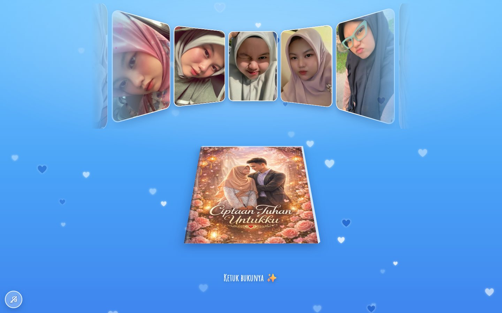
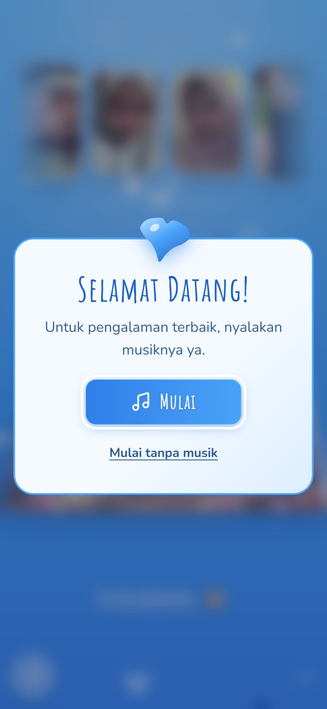
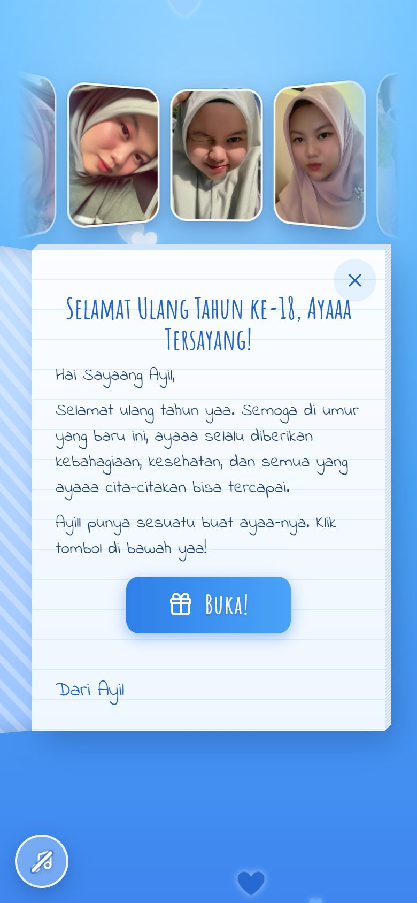
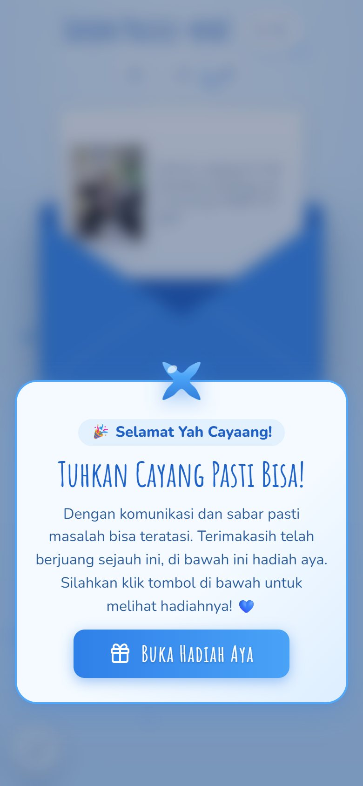
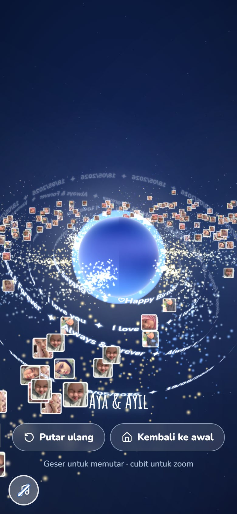

<div align="center">

# 💙 Selamat Ulang Tahun, Aya!

**Kado ulang tahun ke-18 dari Ayil untuk Aya.** Konsep dan alurnya sama seperti versi pertama situs ini (cincin foto, buku berisi surat, puzzle, kue dengan lilin, galaksi kejutan), kini dibuat ulang dengan React, serba biru, dan nyaman dibuka dari HP.

React 19 · Vite 8 · JavaScript · situs statis tanpa backend



</div>

---

## Daftar isi

- [Alur pengalaman](#-alur-pengalaman)
- [Tangkapan layar](#-tangkapan-layar)
- [Animasi](#-animasi)
- [Teknologi](#-teknologi)
- [Menjalankan secara lokal](#-menjalankan-secara-lokal)
- [Perintah yang tersedia](#-perintah-yang-tersedia)
- [Struktur proyek](#-struktur-proyek)
- [Mengubah isi, foto, musik, dan warna](#-mengubah-isi-foto-musik-dan-warna)
- [Musik dan mikrofon](#-musik-dan-mikrofon)
- [Deploy](#-deploy)
- [Aksesibilitas dan performa](#-aksesibilitas-dan-performa)
- [Pengujian](#-pengujian)
- [Pemecahan masalah](#-pemecahan-masalah)
- [Dari versi lama ke versi baru](#-dari-versi-lama-ke-versi-baru)
- [Hak cipta dan privasi](#-hak-cipta-dan-privasi)

---

## 🎁 Alur pengalaman

Ada empat halaman, sama seperti situs aslinya. Setiap halaman punya alamatnya sendiri, jadi bisa di-refresh, dibagikan, dan tombol **Back** di browser bekerja normal.

| Halaman | Alamat | Isi |
| --- | --- | --- |
| **Selamat Datang** | semua halaman | Kartu "Selamat Datang!" dengan hati yang berubah bentuk. Tombol **Mulai** sekaligus memutar musik; ada juga **Mulai tanpa musik**. Tidak ada lagi permintaan izin mikrofon. |
| **1. Beranda** | `#/` | Latar biru dengan hati-hati yang melayang berputar. Di atas, **cincin 3D berisi 10 foto Aya** yang terus berputar: bisa digeser, dan setiap foto bisa dibuka ukuran penuh. Di bawahnya ada **buku "Ciptaan Tuhan Untukku"** yang tergeletak; ketuk sampulnya dan buku terangkat, lalu terbuka menampilkan surat asli. Tombol **Buka!** di dalam surat mengantar ke puzzle. |
| **2. Puzzle** | `#/puzzle` | Kartu "Sebelum Mulai, Aya... 💙", lalu **jigsaw sungguhan** (12 keping berbentuk kancing) dari foto Ayil & Aya. Keping digeser ke papan dan otomatis menempel saat dekat posisinya. Ada tombol **Intip foto**, **Acak**, dan **Bantu**. Setelah selesai, foto bersinar, amplop biru terbuka, konfeti muncul, lalu kartu "Tuhkan Cayang Pasti Bisa!" dengan tombol **Buka Hadiah Aya**. |
| **3. Kue** | `#/kue` | Kartu "Hai Cayaang! 🎂", lalu ketuk kue biru untuk menaruh lilin (maksimal 18). Lilin ditiup lewat **mikrofon**, atau dengan mengetuk apinya, atau dengan tombol **Tiup**. Setelah itu muncul "Ucapkan kata rahasia untuk kejutan!": ketik atau ucapkan *ayil sayang aya*. Tombol **?** membuka bantuan dan pintasan ke halaman berikutnya. |
| **4. Galaksi** | `#/galaksi` | "Kejutan Terakhir!" layar penuh dalam 3D. Ada tulisan "Happy Birthday Ayaa!" di atas planet biru; **sentuh planetnya**, kamera terbang mundur, dan terlihat galaksi spiral yang bintang-bintangnya adalah foto Aya, dengan cincin bertuliskan *♡Happy Birthday Sayang♡ · I love you · Always & Forever · 18/05/2026*. Galaksi bisa diputar dan di-zoom. Tersedia tombol **Putar ulang** dan **Kembali ke awal**. |

Semua teks pribadi (surat, pesan puzzle, instruksi kue, tulisan di cincin) disalin **persis kata per kata** dari situs lama. Satu-satunya perubahan: emoji hati pink 💕💝 diganti 💙.

## 📸 Tangkapan layar

Semua gambar diambil langsung dari aplikasi ini dengan `npm run shots`.

| Selamat Datang | Surat | Puzzle |
| --- | --- | --- |
|  |  |  |

| Puzzle selesai | Kue | Galaksi |
| --- | --- | --- |
|  |  |  |

Versi desktop: [beranda](docs/screenshots/home-desktop.jpg) · [surat](docs/screenshots/letter-desktop.jpg) · [puzzle](docs/screenshots/puzzle-desktop.jpg) · [puzzle selesai](docs/screenshots/puzzle-done-desktop.jpg) · [kue](docs/screenshots/cake-desktop.jpg) · [planet](docs/screenshots/galaxy-start-desktop.jpg) · [galaksi](docs/screenshots/galaxy-desktop.jpg)

## ✨ Animasi

- **Morph hati ↔ bintang**: ikon di atas setiap kartu berdenyut sambil berubah bentuk dari hati menjadi kilau bintang lalu kembali (`src/lib/morphShapes.js`, bentuk SVG dengan struktur titik yang sama sehingga bisa diinterpolasi mulus).
- **Perpindahan halaman berbentuk hati**: setiap tombol yang membuka halaman baru memunculkan hati yang tumbuh dari titik ketukan dan **berubah bentuk menjadi lingkaran** sampai menutupi layar. Halaman baru dipasang di baliknya, lalu lingkaran itu menyusut kembali menjadi hati dan menghilang (`src/context/Transition.jsx`).
- **Amplop**: tutup amplop adalah path SVG yang **berubah bentuk** dari tertutup (mengarah ke bawah) menjadi terbuka (mengarah ke atas), lalu kertas berisi foto keluar.
- **Hati yang berputar** di latar (seperti situs lama, tetapi digerakkan dengan transform CSS sehingga ringan), jejak hati di kursor desktop, buku yang mengambang dan terbuka 3D, baris surat yang muncul satu per satu dari blur, kartu yang melompat masuk dengan pegas, keping puzzle yang memantul ke tempatnya, api lilin yang bergoyang, asap saat lilin padam, konfeti biru-putih-emas, dan galaksi three.js.

Kalau sistem meminta animasi dikurangi (*reduce motion*), semua animasi berulang berhenti, perpindahan halaman langsung, dan galaksi diganti langit statis.

## 🧰 Teknologi

Versi berikut adalah yang benar-benar terpasang di `package-lock.json`.

| Bagian | Paket |
| --- | --- |
| UI | `react` 19.3.1, `react-dom` 19.3.1 |
| Build | `vite` 8.3.5, `@vitejs/plugin-react` 6.1.2 |
| Animasi | `motion` 14.6.0 (`motion/react`) + CSS `@keyframes` |
| 3D (khusus halaman galaksi, dimuat belakangan) | `three` 0.186.1 |
| Ikon / konfeti | `lucide-react` 1.61.0 / `canvas-confetti` 1.9.4 |
| Font (di-host sendiri, seperti versi lama) | `@fontsource/amatic-sc` (judul), `@fontsource/indie-flower` (tulisan tangan di surat), `@fontsource-variable/nunito` (teks) |
| Gaya | CSS Modules + token warna di `src/styles/tokens.css` |
| Uji | `vitest` 5.0.5 + Testing Library (jsdom), `@playwright/test` 1.64.1 |
| Lint | `eslint` 9 + `eslint-plugin-react-hooks` 7 (aturan React Compiler), `eslint-plugin-jsx-a11y`, `eslint-plugin-react-refresh` |

## 🚀 Menjalankan secara lokal

**Persyaratan:** Node.js `^20.19.0` atau `>=22.12.0` (syarat Vite 8, juga tertulis di `engines` pada `package.json`) dan npm.

```bash
git clone https://github.com/SyamayDev/HappyBirthdayAya.git
cd HappyBirthdayAya
npm ci
npm run dev      # buka http://localhost:5173
```

Ingin langsung ke halaman tertentu? Buka `http://localhost:5173/#/puzzle`, `#/kue`, atau `#/galaksi`.

## 📜 Perintah yang tersedia

| Perintah | Fungsi |
| --- | --- |
| `npm run dev` | Server pengembangan dengan hot reload. |
| `npm run build` | Build produksi ke `dist/`. |
| `npm run preview` | Menyajikan `dist/` secara lokal. |
| `npm run lint` | ESLint (folder `legacy/` diabaikan). |
| `npm test` | Uji unit dan komponen (Vitest). |
| `npm run test:watch` | Vitest dalam mode watch. |
| `npm run test:e2e` | Uji browser Playwright terhadap build produksi, di ukuran ponsel (390 px) dan desktop (1440 px). |
| `npm run shots` | Tangkapan layar setiap halaman beserta pemeriksaan error konsol, gambar rusak, dan overflow horizontal. Butuh `npm run dev` yang sedang berjalan. |
| `npm run check` | `lint`, lalu `test`, lalu `build`. |

> Playwright memakai Google Chrome yang terpasang kalau ada. Kalau tidak ada, jalankan `npx playwright install chromium` sekali, atau pilih browser lain dengan `PW_CHANNEL=msedge`.

## 🗂 Struktur proyek

```text
HappyBirthdayAya/
├── index.html                    # entri Vite + meta (judul, deskripsi, OG, favicon)
├── public/                       # favicon.svg, og-image.png
├── src/
│   ├── main.jsx · App.jsx        # mount + pemilihan halaman berdasarkan alamat (#/…)
│   ├── data/content.js           # ⭐ semua teks, foto, musik, dan konfigurasi
│   ├── assets/                   # photos/, illustrations/, audio/
│   ├── styles/                   # tokens.css (warna, font), globals.css (tombol, reset)
│   ├── context/                  # Music, MotionPreference, Journey, Transition (heart wipe), Announcer
│   ├── lib/                      # router, morphShapes, celebrate (konfeti), random, cx
│   ├── hooks/                    # useScrollLock, useMediaQuery, usePageVisible
│   ├── components/
│   │   ├── WelcomeModal/         # kartu "Selamat Datang!"
│   │   ├── Modal/ · MorphIcon/   # kartu ala situs lama + hati yang berubah bentuk
│   │   ├── HeartsBackground/     # latar gradasi + hati yang berputar
│   │   ├── HeartTrail/           # jejak hati di kursor
│   │   ├── MusicButton/ · Lightbox/ · common/ErrorBoundary.jsx
│   └── pages/
│       ├── Home/                 # cincin foto 3D + buku dan surat
│       ├── Puzzle/               # jigsaw, amplop, logika bentuk keping (jigsaw.js)
│       ├── Cake/                 # kue CSS, lilin, tiup via mikrofon, kata rahasia
│       └── Galaxy/               # galaksi three.js + langit statis cadangan
├── e2e/journey.spec.js           # uji Playwright
├── scripts/screenshots.mjs       # tangkapan layar + QA cepat
├── docs/screenshots/             # gambar untuk README
├── legacy/                       # situs HTML versi pertama (utuh, hanya dipindah)
├── vercel.json · .github/workflows/deploy-pages.yml
├── vite.config.js · eslint.config.js · playwright.config.js
└── CLAUDE.md                     # panduan untuk asisten AI di repo ini
```

## 🎨 Mengubah isi, foto, musik, dan warna

Hampir semua perubahan cukup dilakukan di **`src/data/content.js`**.

- **Teks surat, puzzle, kue, dan galaksi.** Ada di objek `letter`, `puzzle`, `cake`, dan `finale`. Teks yang ditandai `// verbatim` berasal dari situs lama.
  > ⚠️ Salam di surat tertulis **"Hai Sayaang Ayil,"**, persis seperti versi lama (Ayil adalah nama pengirim). Kalau maksudnya "Aya", ubah `letter.greeting`.
- **Foto di cincin.** Simpan foto di `src/assets/photos/`, import di bagian atas `content.js`, lalu tambahkan ke array `photos`. Isinya `src` (foto asli), `thumb` (foto kecil; boleh file yang sama), `width`/`height`, `focus` (posisi potongan, misalnya `'50% 40%'`), dan `alt` (deskripsi foto). Urutan dan jumlah foto bebas; sudut cincin dihitung otomatis. Foto yang sama juga dipakai di galaksi.
- **Foto puzzle.** Ganti `puzzle-ayil-aya.webp` dengan rasio 3:4. Jumlah keping diatur di `puzzle.cols` dan `puzzle.rows`.
- **Kata rahasia dan jumlah lilin.** `finale.secret.keyword` (aturan lama: kalimat apa pun yang mengandung kata itu diterima) dan `cake.maxCandles`.
- **Musik.** Ganti `src/assets/audio/backsound.m4a` dan `backsound.mp3` (cadangan), atau ubah `music.sources` dan `music.volume`.
- **Warna dan font.** Semua ada di `src/styles/tokens.css`, misalnya `--page-home` (gradasi beranda), `--page-cake`, `--card-*`, `--btn-*`, dan `--font-title`.

## 🎵 Musik dan mikrofon

- **Musik tidak butuh izin apa pun.** Tombol **Mulai** di kartu Selamat Datang langsung memutar lagu, karena ketukan itu dihitung browser sebagai *user gesture*. Situs lama justru meminta izin mikrofon dulu, dan kalau ditolak, halaman terkunci di balik kartu.
- **Tidak ada autoplay.** Tombol bulat di pojok kiri bawah memutar atau menjeda musik dan selalu menunjukkan keadaan sebenarnya: memuat, diputar, dijeda, ditahan browser, atau tidak tersedia. Musik tetap berlanjut saat pindah halaman, berhenti saat tab disembunyikan, dan lanjut lagi hanya kalau sebelumnya memang sedang diputar.
- **Mikrofon hanya dipakai di halaman Kue**, sesuai instruksi "Tiup kue tersebut (gunakan mikrofon)". Izin baru diminta setelah tombol **Siap, Mulai** ditekan. Suara hanya dianalisis di perangkat, tidak direkam atau dikirim, dan mikrofon dimatikan begitu semua lilin padam atau halaman ditinggalkan. Kalau izin ditolak, lilin tetap bisa ditiup dengan mengetuk apinya atau menekan **Tiup**.
- **Mengucapkan kata rahasia** memakai fitur pengenalan suara browser (Web Speech API), dan hanya aktif kalau tombol **Ucapkan** ditekan. Di Chrome, suara diproses oleh layanan online milik Google. Mengetik kata rahasia selalu bisa.
- File `backsound.mp3` lama ternyata **bukan MP3**, melainkan audio AAC dalam kontainer MP4 dengan ekstensi yang salah, sehingga berisiko gagal di Safari. File itu dikemas ulang tanpa menurunkan kualitas menjadi `backsound.m4a`, plus MP3 asli sebagai cadangan.

## ☁️ Deploy

Build berada di `dist/` dan memakai path relatif (`base: './'`), jadi bisa dibuka dari domain utama maupun subfolder. Halaman berpindah lewat `#/…`, sehingga server tidak perlu pengaturan rewrite.

- **Vercel** (`https://happy-birthday-aya-lovat.vercel.app`): `vercel.json` sudah mengatur preset Vite, `npm ci`, `npm run build`, dan output `dist`. Pengaturan ini perlu karena proyek Vercel lama dibuat untuk HTML statis tanpa build. Cukup push ke `main`.
- **GitHub Pages**: workflow `.github/workflows/deploy-pages.yml` menjalankan lint, test, dan build, lalu menerbitkan `dist/`. **Perlu satu kali pengaturan**: *Settings → Pages → Source: **GitHub Actions***. Tanpa itu, Pages akan menampilkan halaman kosong.

## ♿ Aksesibilitas dan performa

- **Bisa dipakai dengan keyboard**: foto di cincin bisa difokus (cincin otomatis berputar ke foto itu, Enter membukanya), buku, kartu-kartu (Esc menutup), keping puzzle (Enter memasang keping yang sedang difokus), lilin (setiap api adalah tombol), dan kata rahasia.
- **Ramah pembaca layar**: kartu memakai `<dialog>` asli sehingga fokus terkunci di dalamnya. Semua tombol ikon punya nama, pengumuman penting disampaikan lewat wilayah `aria-live`, dan semua tulisan di galaksi juga tersedia sebagai teks biasa.
- **Responsif dan sudah diuji**: tidak ada scroll horizontal di lebar 320, 360, 768, 1024, dan 1440 px, di keempat halaman. Puzzle dan kue mengatur ulang ukuran untuk HP. Posisi keping disimpan relatif terhadap layar, jadi tidak hilang saat HP diputar.
- **Ringan**: three.js (± 145 KB gzip) hanya dimuat di halaman galaksi, dan rendering berhenti saat tab disembunyikan. Foto di cincin memakai WebP 600 px, sedangkan foto penuh hanya dimuat saat dibuka. Font di-host sendiri. Animasi berulang hanya memakai `transform` dan `opacity`.
- **Tahan gangguan**: setiap halaman dibungkus *error boundary*, audio yang gagal dimuat tidak merusak halaman, dan tanpa WebGL bab terakhir otomatis memakai langit statis.

## 🧪 Pengujian

Hasil terakhir yang benar-benar dijalankan:

- `npm run lint`: bersih.
- `npm test`: **32 uji lulus dari 6 file**. Cakupannya:
  - router, kartu selamat datang (musik sekali, tanpa mikrofon), dan buka halaman langsung atau lewat Back;
  - cincin foto dan penampil foto, serta buku (tanpa bubbling, fokus);
  - geometri jigsaw (sisi saling cocok, snap, tata letak HP dan desktop) dan alur puzzle sampai pesan sukses;
  - lilin (maksimal 18, ketuk, tiup, kata rahasia, mikrofon ditolak, bantuan);
  - langit statis tanpa WebGL, dan musik (diblokir, gagal, jeda saat tab tersembunyi).
- `npm run test:e2e`: **10 uji lulus** (5 skenario × ponsel dan desktop) di Chrome terhadap build produksi:
  - perjalanan lengkap termasuk **menggeser keping puzzle sungguhan**, tanpa error konsol atau request gagal;
  - musik tanpa permintaan mikrofon;
  - semua halaman bisa dibuka langsung dan di-refresh;
  - mode reduced motion;
  - tanpa overflow horizontal di 5 lebar layar.
- `npm run build`: berhasil.

## 🛟 Pemecahan masalah

| Masalah | Solusi |
| --- | --- |
| Musik tidak berbunyi | Matikan mode senyap, lalu ketuk tombol musik di kiri bawah. Kalau tidak tersedia, cek tab Network untuk file `backsound`. |
| Mikrofon tidak mendeteksi tiupan | Izinkan mikrofon untuk situs ini, tiup dari dekat, atau cukup ketuk apinya. Ambang deteksi bisa diubah di `THRESHOLD` dalam `src/pages/Cake/useBlowDetector.js`. |
| Tombol "Ucapkan" tidak muncul | Browser tidak mendukung Web Speech API (misalnya Firefox). Ketik saja kata rahasianya. |
| Galaksi tidak tampil 3D | Itu fallback yang disengaja: WebGL tidak tersedia, atau perangkat meminta animasi dikurangi. |
| Foto tidak muncul | Cek nama file dan import di `content.js`. Huruf besar/kecil berpengaruh di Vercel/Pages, dan build gagal kalau file yang di-import tidak ada. |
| Halaman kosong di GitHub Pages | Ubah Source Pages menjadi **GitHub Actions**. |
| `npm run test:e2e` gagal membuka browser | Pasang Chrome, atau jalankan `npx playwright install chromium`. |

## 🔁 Dari versi lama ke versi baru

Situs lama **tidak dihapus**, hanya dipindah dengan `git mv` ke **`legacy/`** (riwayat git tetap utuh) dan masih bisa dibuka dari `legacy/index.html`. Folder itu tidak ikut build, jadi boleh dihapus kapan saja kalau sudah tidak diperlukan.

| Lama | Baru |
| --- | --- |
| `index.html` (permission modal + carousel + buku) | `WelcomeModal` + `pages/Home` |
| `puzzle-together-photos/` | `pages/Puzzle` (jigsaw dibangun ulang) |
| `cake-blow-main/` | `pages/Cake` |
| `Galaxy-love-main/` | `pages/Galaxy` |
| `heart-animation-main/`, `heart-trail-animation-main/` | `HeartsBackground`, `HeartTrail` |
| `envelope-modal/` (tidak pernah dipakai) | Amplop di akhir puzzle; tulisannya ("Selamat cayaang berhasil…") kini muncul di kertas amplop |
| `Galaxy-love-main/images/img1…5, 7…11.jpg` | `src/assets/photos/aya-01…10.jpg` (isi identik) + thumbnail `-sm.webp` |
| `puzzle-together-photos/images/img12.jpg` | `puzzle-ayil-aya.webp` (dipotong ke area foto di dalam bingkai putihnya) |
| `card-animation/images/cover-book.jpg` | `src/assets/illustrations/book-cover.webp` |
| `backsound.mp3` (sebenarnya AAC/MP4) | `backsound.m4a` (dikemas ulang tanpa re-encode) + `backsound.mp3` |

Bug lama yang diperbaiki:

- Musik meminta izin mikrofon, dan kalau ditolak halaman terkunci.
- Musik YouTube dan MP3 bisa berbunyi bersamaan.
- Tombol **Buka!** ikut menutup buku.
- 80 hati di latar digeser lewat `left`/`top` setiap frame (berat).
- Puzzle dijalankan dua kali per klik, macet kalau CDN gagal, keping hilang saat HP diputar, dan tidak bisa dipakai dengan keyboard.
- Mikrofon di halaman kue tidak pernah dilepas, dan lilin hanya bisa ditiup lewat mikrofon.
- Galaksi punya dua loop animasi dan kebocoran memori, musiknya tidak pernah berbunyi, dan halamannya buntu tanpa jalan lanjut.

## ©️ Hak cipta dan privasi

- **Foto pribadi** (Aya, serta Ayil & Aya) adalah milik pemiliknya.
- **Lagu latar**: judul dan asal-usulnya tidak tercatat di file (berasal dari YouTube). Ganti dengan lagu yang Anda punya haknya kalau situs akan dibagikan luas.
- **Ilustrasi sampul buku** "Ciptaan Tuhan Untukku": asal-usulnya tidak tercatat di repo.
- **`legacy/`** sebagian memakai template pihak lain, sesuai catatan di file-filenya: *Heart Animation* (Emmanuel Jose, "All Rights Reserved" untuk aset visualnya), *Heart Trail Animation* (paribhandarkar), template jigsaw dari CodePen, dan three.js r152. **Versi React ini ditulis ulang dan tidak memakai kode atau aset dari template-template itu.**
- **Privasi:** situs ini bukan halaman privat. Siapa pun yang punya tautannya bisa melihat dan mengunduh foto, surat, dan lagunya. `index.html` memakai `noindex, nofollow` supaya tidak diindeks mesin pencari, tetapi itu bukan pengaman, jadi bagikan tautannya dengan bijak. Gambar pratinjau tautan (`og-image.png`) sengaja tidak memuat foto pribadi.

---

<div align="center">

Untuk **Aya**, yang berulang tahun ke-18 pada 18 Mei 2026. Dibuat dengan 💙 oleh **Ayil** ([@SyamayDev](https://github.com/SyamayDev)).

</div>
