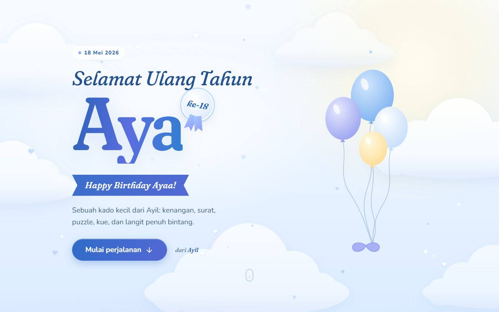
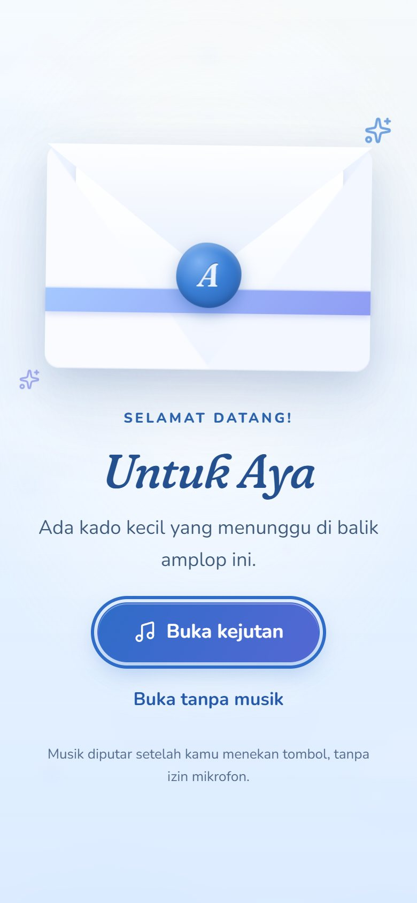
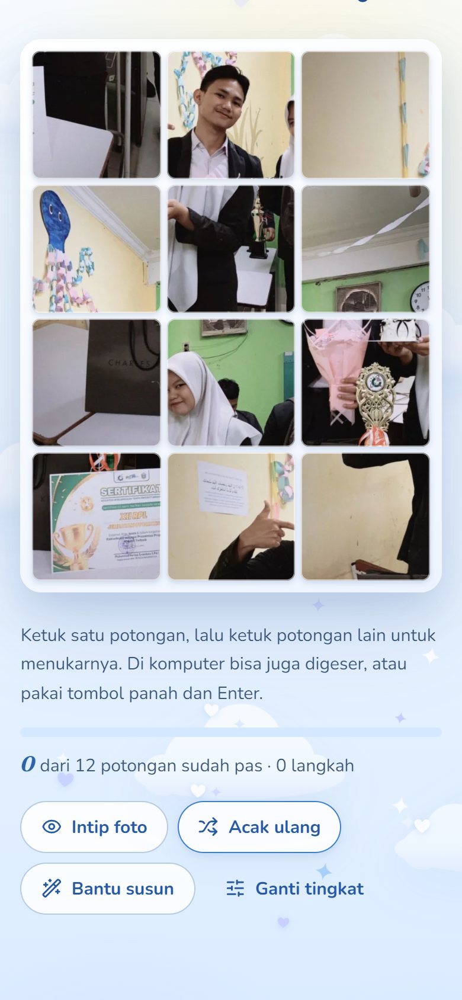
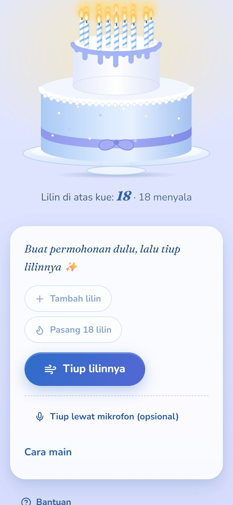
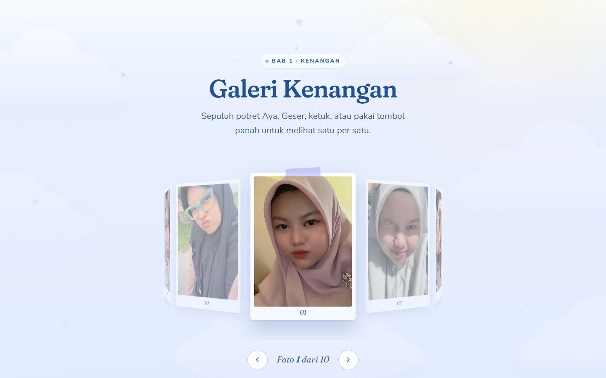
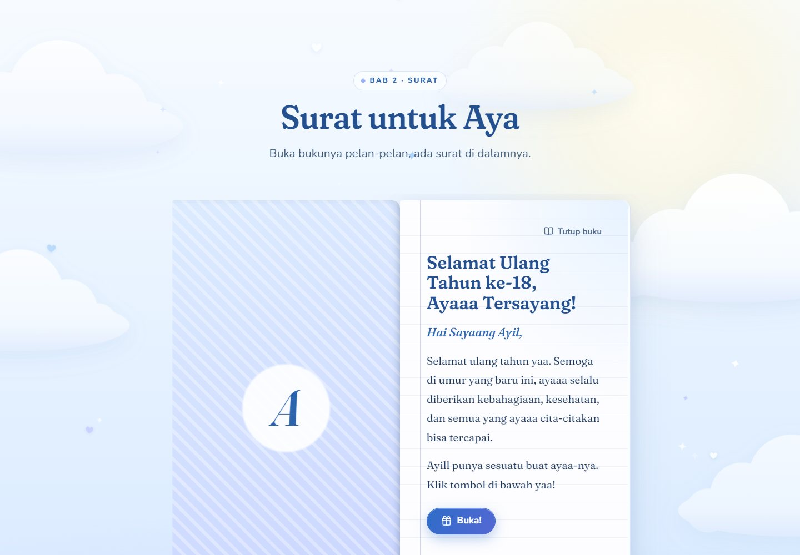
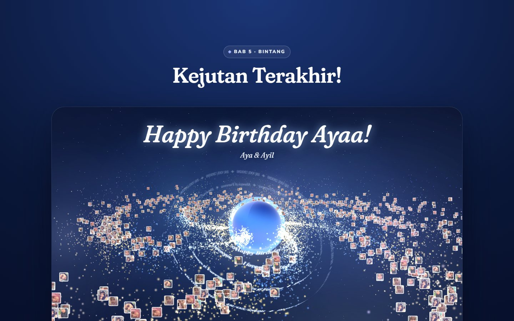

<div align="center">

# 💙 Selamat Ulang Tahun ke-18, Aya

**Kado ulang tahun interaktif dari Ayil untuk Aya.** Sebuah perjalanan kecil di langit biru: amplop undangan, galeri kenangan 3D, surat di dalam buku, puzzle foto, kue dengan 18 lilin, dan galaksi penuh foto di akhir cerita.

React 19 · Vite 8 · JavaScript · tanpa backend



</div>

---

## Daftar isi

- [Pengalaman yang dibangun](#-pengalaman-yang-dibangun)
- [Tangkapan layar](#-tangkapan-layar)
- [Teknologi](#-teknologi)
- [Menjalankan secara lokal](#-menjalankan-secara-lokal)
- [Perintah yang tersedia](#-perintah-yang-tersedia)
- [Struktur proyek](#-struktur-proyek)
- [Mengubah isi, foto, musik, dan tema](#-mengubah-isi-foto-musik-dan-tema)
- [Musik, autoplay, dan mikrofon](#-musik-autoplay-dan-mikrofon)
- [Deploy](#-deploy)
- [Aksesibilitas, gerak, dan performa](#-aksesibilitas-gerak-dan-performa)
- [Pengujian](#-pengujian)
- [Pemecahan masalah](#-pemecahan-masalah)
- [Dari versi lama ke versi baru](#-dari-versi-lama-ke-versi-baru)
- [Atribusi, hak cipta, dan privasi](#-atribusi-hak-cipta-dan-privasi)
- [Terima kasih](#-terima-kasih)

---

## ✨ Pengalaman yang dibangun

Satu halaman dengan enam bab. Setiap bab punya tombol lanjut, dan semua bab bisa dibuka dari menu di dok bawah.

| Bab | Isi | Interaksi |
| --- | --- | --- |
| **Pembuka** | Amplop dengan segel lilin "A" dan pita, lalu halaman utama "Selamat Ulang Tahun, **Aya**" dengan lencana *ke-18*, balon, dan awan. | Pilih **Buka kejutan** (dengan musik) atau **Buka tanpa musik**. Saat amplop terbuka, segelnya lepas dan tutupnya terangkat. |
| **1 · Kenangan** | 10 foto Aya dalam cincin 3D berbingkai polaroid. | Tombol panah, geser, tombol ← → di keyboard, rel foto kecil, putar otomatis yang bisa dijeda, dan penampil foto ukuran penuh (`<dialog>`). |
| **2 · Surat** | Buku bersampul *Ciptaan Tuhan Untukku*. Isinya surat asli kata per kata. | Sampul berayun terbuka: di layar lebar jadi dua halaman, di ponsel sampulnya menyingkir. Tombol **Buka!** mengantar ke puzzle. |
| **3 · Puzzle** | Foto Ayil & Aya (12 keping, atau 20 keping di tingkat *Seru*). | Ketuk dua keping untuk menukar posisinya. Di komputer bisa juga digeser, atau pakai tombol panah lalu Enter. Ada tombol **Intip foto**, **Acak ulang**, dan **Bantu susun**. Progres tersimpan saat halaman dimuat ulang. Setelah selesai, pesan asli "Tuhkan Cayang Pasti Bisa!" muncul. |
| **4 · Kue** | Kue dua tingkat biru-mutiara dari SVG. | Ketuk permukaan kue untuk menaruh lilin (maksimal 18). Tiup lilin dengan mengetuk apinya, menekan tombol **Tiup lilinnya**, atau lewat mikrofon (opsional). Ada tombol **Nyalakan lagi**. |
| **5 · Bintang** | "Kejutan Terakhir!": dibuka dengan kata rahasia, lalu tampil galaksi three.js berisi foto-foto Aya. Cincin bertuliskan pesan mengelilingi planet. | Kata rahasia (punya petunjuk, dan bisa dilewati). Animasi pembuka bisa dilewati, galaksi bisa dijelajahi. Tersedia tombol untuk melihat kenangan lagi, menyalakan lilin lagi, atau memutar ulang dari awal. |

Detail lainnya:

- **Dok kontrol**: penanda bab yang sedang dibaca, menu bab (centang ✓ untuk bab yang sudah selesai, ikon gembok untuk bab terakhir), tombol musik yang mengikuti status audio sebenarnya, dan tombol **Animasi hemat**.
- **Konfeti biru**: muncul sekali tiap momen penting (puzzle selesai, semua lilin padam, kejutan terakhir terbuka) dan tidak pernah berulang terus-menerus.
- **Progres tersimpan** di `localStorage`. Datanya divalidasi saat dibaca, jadi data rusak diabaikan, dan **Putar ulang dari awal** menghapusnya.
- **Tombol Back** di browser kembali ke bab sebelumnya, karena setiap bab punya alamat `#bab` sendiri.

## 📸 Tangkapan layar

Semua gambar diambil langsung dari aplikasi ini (`docs/screenshots/`).

| Undangan (ponsel) | Puzzle (ponsel) | Kue (ponsel) |
| --- | --- | --- |
|  |  |  |

| Galeri kenangan | Surat di dalam buku | Galaksi kejutan terakhir |
| --- | --- | --- |
|  |  |  |

## 🧰 Teknologi

Versi di bawah ini adalah versi yang terpasang di `package-lock.json`.

| Bagian | Paket |
| --- | --- |
| UI | `react` 19.3.1, `react-dom` 19.3.1 |
| Build & dev server | `vite` 8.3.5, `@vitejs/plugin-react` 6.1.2 |
| Animasi | `motion` 14.6.0 (`motion/react`) dan CSS `@keyframes` untuk dekorasi |
| 3D (hanya untuk bab terakhir, dimuat belakangan) | `three` 0.186.1 |
| Ikon | `lucide-react` 1.61.0 |
| Konfeti | `canvas-confetti` 1.9.4 |
| Font (di-host sendiri, tanpa Google Fonts) | `@fontsource-variable/fraunces` (judul), `@fontsource-variable/nunito` (teks) |
| Gaya | CSS Modules dan design token di `src/styles/tokens.css` |
| Uji unit | `vitest` 5.0.5, `jsdom`, `@testing-library/react`, `user-event`, `jest-dom` |
| Uji browser | `@playwright/test` 1.64.1 |
| Lint | `eslint` 9, `eslint-plugin-react-hooks` 7 (termasuk aturan React Compiler), `eslint-plugin-jsx-a11y`, `eslint-plugin-react-refresh` |

## 🚀 Menjalankan secara lokal

**Persyaratan:** Node.js `^20.19.0` atau `>=22.12.0` (sesuai syarat Vite 8, juga tertulis di `engines` pada `package.json`) dan npm.

```bash
git clone https://github.com/SyamayDev/HappyBirthdayAya.git
cd HappyBirthdayAya
npm ci           # instal sesuai package-lock.json
npm run dev      # buka http://localhost:5173
```

## 📜 Perintah yang tersedia

| Perintah | Fungsi |
| --- | --- |
| `npm run dev` | Server pengembangan Vite dengan hot reload. |
| `npm run build` | Build produksi ke `dist/`. |
| `npm run preview` | Menyajikan hasil `dist/` secara lokal. |
| `npm run lint` | ESLint untuk seluruh proyek (folder `legacy/` diabaikan). |
| `npm test` | Semua uji unit dan komponen sekali jalan (Vitest). |
| `npm run test:watch` | Vitest dalam mode watch. |
| `npm run test:e2e` | Uji browser Playwright: otomatis menjalankan `build` dan `preview`, lalu menguji di ukuran ponsel dan desktop. |
| `npm run shots` | Mengambil tangkapan layar tiap bab dan memeriksa error konsole, request gagal, gambar rusak, serta overflow horizontal. Butuh `npm run dev` yang sedang berjalan. |
| `npm run check` | `lint`, lalu `test`, lalu `build`. |

> Playwright memakai Google Chrome yang sudah terpasang kalau ada. Kalau tidak ada, jalankan `npx playwright install chromium` sekali, atau pilih browser lain dengan `PW_CHANNEL=msedge`.

## 🗂 Struktur proyek

```text
HappyBirthdayAya/
├── index.html                  # entri Vite + meta (judul, deskripsi, OG, favicon)
├── public/
│   ├── favicon.svg
│   └── og-image.png            # pratinjau tautan (diambil dari hero, tanpa foto pribadi)
├── src/
│   ├── main.jsx                # mount React, font, gaya global, ErrorBoundary
│   ├── App.jsx                 # susunan bab
│   ├── data/content.js         # ⭐ SEMUA teks, foto, dan konfigurasi
│   ├── assets/
│   │   ├── photos/             # aya-01…10.jpg (asli) + *-sm.webp (thumbnail 600px) + foto puzzle
│   │   ├── illustrations/      # book-cover.webp
│   │   └── audio/              # backsound.m4a (+ backsound.mp3 cadangan)
│   ├── styles/
│   │   ├── tokens.css          # warna, tipografi, jarak, radius, bayangan, durasi
│   │   └── globals.css         # reset, tombol .btn, utilitas, reduced-motion global
│   ├── context/                # Journey (progres), Music, MotionPreference, Announcer
│   ├── hooks/                  # useScrollLock, usePageVisible, useActiveChapter, useMediaQuery
│   ├── lib/                    # navigasi bab, localStorage aman, konfeti, RNG ber-seed
│   ├── components/
│   │   ├── OpeningGate/        # amplop undangan
│   │   ├── Hero/               # halaman pembuka + balon
│   │   ├── SkyBackdrop/        # langit, awan, kilau, hati melayang
│   │   ├── MemoryCarousel/     # cincin foto 3D + Lightbox
│   │   ├── LetterBook/         # buku & surat
│   │   ├── PhotoPuzzle/        # puzzle tukar keping + logika murni
│   │   ├── BirthdayCake/       # kue SVG, lilin, deteksi tiupan (opsional)
│   │   ├── GalaxyFinale/       # pintu kata rahasia, galaksi three.js, langit statis
│   │   ├── Dock/               # navigasi bab, musik, animasi hemat
│   │   ├── SparkleTrail/       # jejak kilau kursor (desktop)
│   │   └── common/             # Chapter, Reveal, ErrorBoundary
│   ├── dev/Harness.jsx         # khusus development: tampilkan satu bab (?harness=kue)
│   └── test/                   # setup Vitest + helper render
├── e2e/journey.spec.js         # uji Playwright
├── scripts/screenshots.mjs     # tangkapan layar + QA cepat
├── docs/screenshots/           # gambar untuk README
├── legacy/                     # versi HTML lama (lihat bagian migrasi)
├── vercel.json                 # konfigurasi build untuk Vercel
├── .github/workflows/deploy-pages.yml
├── vite.config.js · eslint.config.js · playwright.config.js
└── CLAUDE.md                   # panduan untuk asisten AI yang mengerjakan repo ini
```

## 🎨 Mengubah isi, foto, musik, dan tema

Hampir semua perubahan cukup dilakukan di **`src/data/content.js`**.

- **Teks.** Ubah string di file tersebut. Teks yang ditandai `// verbatim` berasal dari situs lama.
  > ⚠️ Salam di surat tertulis **"Hai Sayaang Ayil,"**, persis seperti versi lama (Ayil adalah nama pengirim). Kalau maksudnya "Aya", ubah `letter.greeting`.
- **Foto galeri.** Simpan foto di `src/assets/photos/`, import di bagian atas `content.js`, lalu tambahkan objeknya ke array `photos`: `src` (foto asli), `thumb` (opsional, boleh pakai file yang sama), `width`/`height`, `focus` (posisi potongan, misalnya `'50% 40%'`), dan `alt` (deskripsi foto). Urutan di array menentukan urutan di cincin. Jumlah foto boleh berubah, sudut cincin dihitung otomatis.
- **Foto puzzle.** Ganti `puzzle-ayil-aya.webp`. Rasio sebaiknya 3:4. Ukurannya dicatat di `puzzle.image`.
- **Musik.** Ganti `src/assets/audio/backsound.m4a` (dan `.mp3` cadangannya), atau ubah `music.sources`. Volume diatur di `music.volume`.
- **Tanggal, umur, kata rahasia.** `birthday`, `cake.maxCandles` (sama dengan umur), dan `finale.secret.keyword`. Aturan lamanya dipertahankan: kalimat apa pun yang mengandung "sayang" diterima.
- **Warna dan tipografi.** Semua token ada di `src/styles/tokens.css` (`--sky-*`, `--periwinkle-*`, `--ink`, gradien, radius, bayangan, durasi). Catatan kontras ada di komentar paling atas file itu.

Tips: jalankan `npm run dev`, lalu buka `http://localhost:5173/?harness=kue` (atau `kenangan`, `surat`, `hadiah`, `bintang`, `hero`, `gate&started=0`) untuk mengerjakan satu bab saja.

## 🎵 Musik, autoplay, dan mikrofon

- **Musik tidak pernah meminta izin mikrofon.** Lagu diputar dari klik tombol **Buka kejutan**: `audio.play()` dipanggil langsung di dalam klik, jadi browser mengizinkannya. Situs lama meminta izin mikrofon sebelum musik bisa berjalan, dan kalau izin ditolak, halaman terkunci.
- **Tidak ada autoplay** sebelum ada klik. Pilih **Buka tanpa musik** kalau ingin tanpa suara. Musik bisa diputar atau dijeda kapan saja dari dok.
- **Status tombol mengikuti audio yang sebenarnya.** Ada lima keadaan: memuat, diputar, dijeda, *diblokir browser* (ketuk lagi), dan *tidak tersedia* (file gagal dimuat; halaman tetap berjalan normal dan ada tombol coba lagi).
- Saat tab disembunyikan, musik dijeda. Saat tab dibuka lagi, musik lanjut **hanya kalau sebelumnya memang sedang diputar**. Jeda yang disengaja tidak pernah ditimpa.
- **Mikrofon hanya dipakai di bab Kue, dan hanya jika diminta.** Izin baru diminta setelah menekan tombol *"Tiup lewat mikrofon (opsional)"*. Suara hanya dianalisis di perangkat (Web Audio `AnalyserNode`), tidak direkam atau dikirim. Mikrofon dilepas begitu semua lilin padam, saat tombol dimatikan, atau saat halaman ditutup. Cara mengetuk dan tombol tetap selalu bisa dipakai.
- File `backsound.mp3` lama ternyata **bukan MP3**, melainkan audio AAC dalam kontainer MP4/DASH (dari YouTube) dengan ekstensi yang salah. File itu dikemas ulang **tanpa re-encode** menjadi `backsound.m4a`, plus `backsound.mp3` asli (160 kbps) sebagai cadangan untuk browser yang tidak mendukung AAC. Browser memilih sendiri yang bisa diputar.

## ☁️ Deploy

Situs ini statis. Output build ada di `dist/`, dan konfigurasinya memakai `base: './'` sehingga semua path aset relatif. Satu build yang sama bisa dipakai di domain utama maupun subfolder.

**Vercel** (`https://happy-birthday-aya-lovat.vercel.app`, sesuai *homepage* repo)
`vercel.json` mengatur `framework: vite`, `npm ci`, `npm run build`, dan output `dist`. Pengaturan ini ditulis eksplisit karena proyek Vercel lama dibuat untuk HTML statis tanpa build. Aset di `/assets/*` diberi cache jangka panjang (nama filenya sudah ber-hash). Tinggal push ke `main`.

**GitHub Pages**
Workflow `.github/workflows/deploy-pages.yml` menjalankan lint, test, dan build, lalu menerbitkan `dist/`. **Perlu satu kali pengaturan:** *Settings → Pages → Build and deployment → Source: **GitHub Actions***. Tanpa pengaturan itu, Pages masih menyajikan file mentah repo (versi React tidak berjalan tanpa build).

> Tag Open Graph di `index.html` mengarah ke domain Vercel di atas. Kalau domainnya berubah, perbarui `og:url` dan `og:image`.

## ♿ Aksesibilitas, gerak, dan performa

Yang sudah diterapkan dan diperiksa:

- **Keyboard di semua bagian**: undangan, galeri (← →), penampil foto (Esc dan ← →), buku, puzzle (panah, Enter, Esc), kue (setiap api adalah tombol, plus tombol pengganti untuk semua aksi), pintu kata rahasia, dan menu bab (Esc menutup, fokus dikembalikan).
- **Fokus dipindahkan dengan sengaja**: setelah navigasi bab, fokus ke judul bab. Setelah surat dibuka, ke judul surat. Setelah puzzle selesai, ke pesan sukses. Setelah penampil foto ditutup, kembali ke kartu foto.
- **Label dan pengumuman**: semua tombol ikon punya nama, dan pembaca layar diberi tahu lewat satu wilayah `aria-live` yang sopan (puzzle selesai, lilin padam, musik gagal). Animasi dekoratif disembunyikan dari teknologi bantu (`aria-hidden`, `pointer-events: none`).
- **Kontras**: token teks diperiksa mencapai WCAG AA (lihat `tokens.css`). Status tidak hanya ditandai lewat warna (keping puzzle yang pas punya ikon ✓, bab di menu punya ikon ✓ atau gembok).
- **Reduced motion**: mengikuti `prefers-reduced-motion`, dan bisa juga diaktifkan lewat tombol **Animasi hemat** (tersimpan). Saat aktif, putar otomatis, hati melayang, jejak kursor, konfeti, dan animasi kamera 3D dimatikan. Bab terakhir memakai langit statis CSS, dan transisi menjadi instan.
- **Tanpa WebGL**: bab terakhir otomatis memakai langit statis berisi foto yang sama. Semua teks (*Happy Birthday Ayaa!*, keempat pesan cincin, *Aya & Ayil*) tetap ada sebagai teks HTML biasa, tidak hanya di dalam canvas.
- **Performa**:
  - Animasi berulang hanya memakai `transform` dan `opacity`. 80 hati lama yang menggeser `left`/`top` setiap frame diganti 10 hati CSS.
  - three.js dipisah ke chunk sendiri (± 144 KB gzip) yang baru dimuat saat kejutan terakhir dibuka dan mendekati layar.
  - Galeri memakai thumbnail WebP 600 px (± 0,44 MB untuk 10 foto, dibanding 1,2 MB versi asli). Foto ukuran penuh hanya dimuat di penampil foto.
  - Loop 3D berhenti saat tab tersembunyi atau di luar layar, dan semua resource dibersihkan saat ditutup.
  - Font di-host sendiri.
- **Ketahanan**: setiap bab dibungkus *error boundary*. Foto yang gagal dimuat diganti placeholder, audio yang gagal tidak merusak halaman, dan data `localStorage` divalidasi.

## 🧪 Pengujian

Hasil terakhir yang benar-benar dijalankan:

- `npm run lint`: bersih.
- `npm test`: **72 uji lulus dari 11 file**. Cakupannya mencakup music state machine (diblokir, gagal, jeda saat tab tersembunyi), progres dan reset, undangan (play hanya sekali, tanpa mikrofon), dok, galeri (wrap-around, keyboard, autoplay, penampil foto, fallback foto rusak), buku (tanpa bubbling), logika dan alur puzzle (keyboard, simpan dan muat ulang, data rusak), kue (maksimal 18, ketuk, tiup, mikrofon ditolak, stream dilepas), dan kata rahasia beserta tombol-tombol penutup.
- `npm run test:e2e`: **10 uji lulus** (5 skenario × ukuran ponsel 390 px dan desktop 1440 px) di Chrome terhadap build produksi. Skenarionya: perjalanan lengkap dari undangan sampai galaksi tanpa error konsole atau request gagal, musik tanpa permintaan mikrofon, progres tetap ada setelah reload, mode reduced motion, dan tanpa overflow horizontal di lebar 320, 360, 768, 1024, dan 1440 px.
- `npm run build`: berhasil.

## 🛟 Pemecahan masalah

| Masalah | Solusi |
| --- | --- |
| Musik tidak berbunyi | Pastikan perangkat tidak dalam mode senyap, lalu ketuk tombol musik di dok. Kalau status *"Ketuk untuk memutar"* muncul, browser menahan audio, jadi ketuk sekali lagi. Status *"Tidak ada musik"* berarti file gagal dimuat (cek tab Network). |
| Foto tidak muncul | Cek nama file dan import di `content.js`. Huruf besar/kecil berpengaruh di server Linux (Vercel/GitHub Pages). Build Vite gagal kalau file yang di-import tidak ada. |
| Halaman putih di GitHub Pages | Ubah Source Pages menjadi **GitHub Actions** (lihat [Deploy](#-deploy)). |
| Vercel menyajikan file mentah | Pastikan `vercel.json` ikut ter-push. File itu memaksa preset Vite, `npm run build`, dan output `dist`. |
| Galaksi tidak tampil (yang muncul langit statis) | Itu fallback yang disengaja: WebGL tidak tersedia, atau mode reduced motion / Animasi hemat sedang aktif. |
| Progres puzzle atau kue "nyangkut" | Tekan **Putar ulang dari awal** di bab terakhir, atau hapus data situs. Semua data tersimpan dengan awalan `aya:` di `localStorage`. |
| `npm run test:e2e` gagal membuka browser | Pasang Chrome, atau jalankan `npx playwright install chromium`. |
| Versi Node tidak cocok | Gunakan Node 20.19+ atau 22.12+. |

## 🔁 Dari versi lama ke versi baru

Situs HTML lama **tidak dihapus**, hanya dipindahkan dengan `git mv` ke **`legacy/`** sehingga riwayat git-nya tetap utuh dan masih bisa dibuka (`legacy/index.html`). Folder itu tidak ikut build dan diabaikan lint. Silakan dihapus kapan saja kalau sudah tidak diperlukan.

Pemetaan aset:

| Lama | Baru |
| --- | --- |
| `Galaxy-love-main/images/img1…5.jpg`, `img7…11.jpg` (tidak pernah ada `img6`) | `src/assets/photos/aya-01…10.jpg` (isi identik, sudah dicek hash) + `aya-XX-sm.webp` |
| `puzzle-together-photos/images/img12.jpg` | `src/assets/photos/puzzle-ayil-aya.webp` (dipotong ke area foto di dalam bingkai instax putihnya, agar tidak ada keping yang kosong putih) |
| `card-animation/images/cover-book.jpg` | `src/assets/illustrations/book-cover.webp` |
| `backsound.mp3` (sebenarnya AAC/MP4) | `src/assets/audio/backsound.m4a` (dikemas ulang tanpa re-encode) + `backsound.mp3` (MP3 asli) |
| `Galaxy-love-main/gif.gif`, `heart-animation-main/Assets/*` (termasuk GIF 28 MB) | Tidak dipakai: hanya pratinjau dan aset template. |

Bug lama yang diperbaiki di versi ini dicatat di riwayat pengerjaan. Beberapa di antaranya: izin mikrofon untuk musik, musik ganda (YouTube + MP3), tombol **Buka!** yang ikut menutup buku, puzzle yang dijalankan dua kali per klik, galaksi dengan dua loop animasi dan kebocoran memori, serta halaman akhir yang buntu tanpa jalan lanjut.

## ©️ Atribusi, hak cipta, dan privasi

- **Foto pribadi** (Aya, serta Ayil & Aya) adalah milik pemiliknya. Jangan digunakan ulang tanpa izin.
- **Lagu latar**: asal-usul dan judulnya tidak tercatat di file (metadata menunjukkan file berasal dari YouTube). Hak ciptanya milik pemegang hak masing-masing. Ganti dengan lagu yang Anda punya haknya kalau situs akan dibagikan luas.
- **Ilustrasi sampul buku** "Ciptaan Tuhan Untukku": asal-usulnya tidak tercatat di repo.
- **Kode di `legacy/`** sebagian berasal dari template pihak lain, sesuai catatan di dalam file-filenya: *Heart Animation* oleh Emmanuel Jose (README-nya menyatakan *"All visual assets … © Emmanuel Jose. All Rights Reserved."*), *Heart Trail Animation* oleh paribhandarkar, sebuah template puzzle jigsaw dari CodePen, dan three.js r152. **Versi React ini tidak memakai kode maupun aset dari template-template tersebut**; semuanya ditulis ulang.
- Paket npm dipakai sesuai lisensinya masing-masing (lihat `node_modules/*/LICENSE`).

**Catatan privasi:** situs ini bukan halaman privat. Siapa pun yang punya tautannya bisa melihat dan mengunduh foto, surat, dan lagu, karena semuanya disajikan sebagai file statis publik. `index.html` sudah memakai `<meta name="robots" content="noindex, nofollow">` supaya tidak diindeks mesin pencari, tetapi itu bukan pengaman. Bagikan tautannya dengan bijak.

## 💐 Terima kasih

Untuk **Aya**, yang berulang tahun ke-18 pada 18 Mei 2026. Dibuat dengan 💙 oleh **Ayil** ([@SyamayDev](https://github.com/SyamayDev)).
